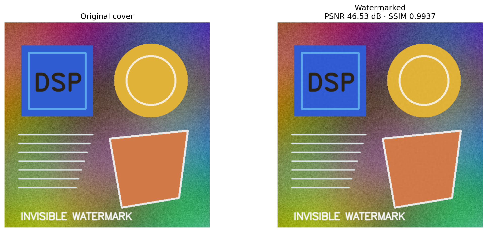
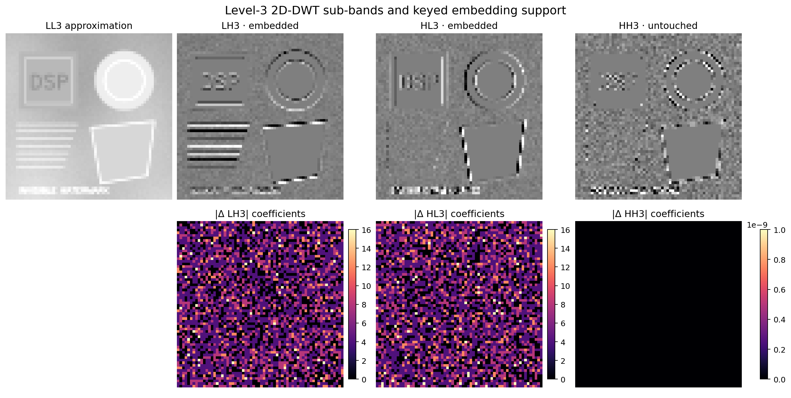
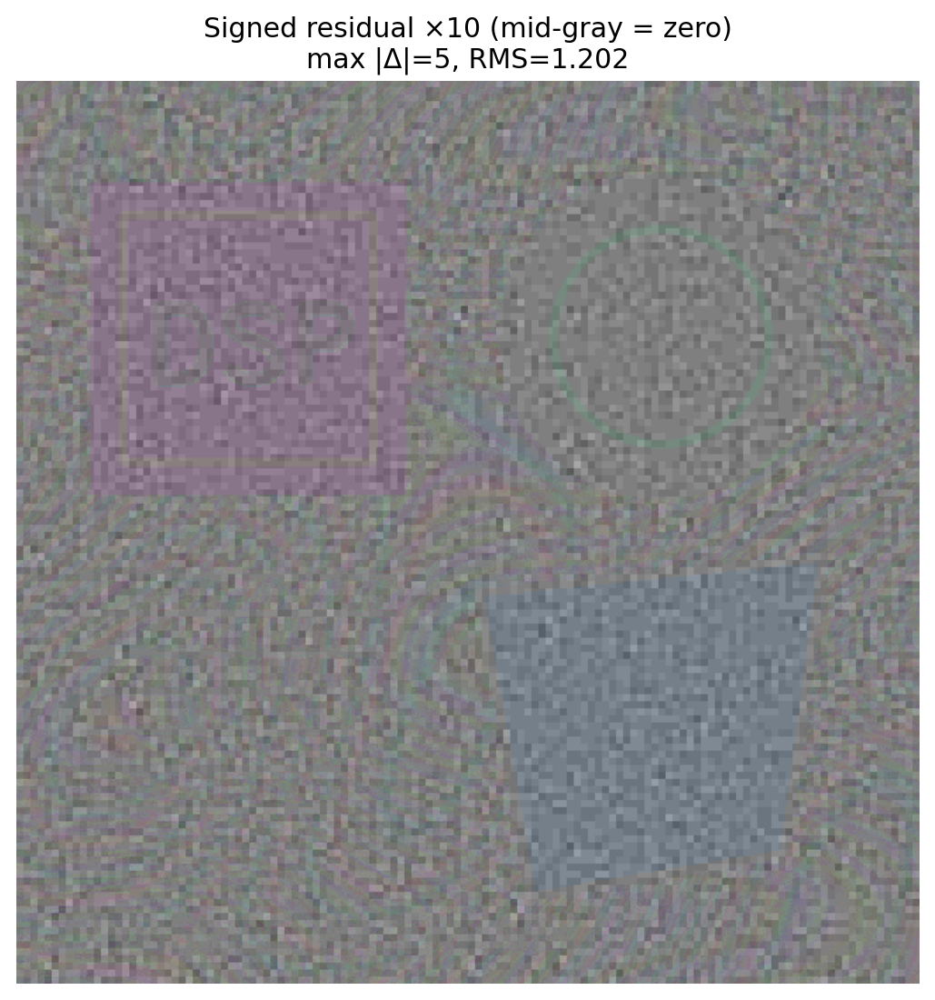
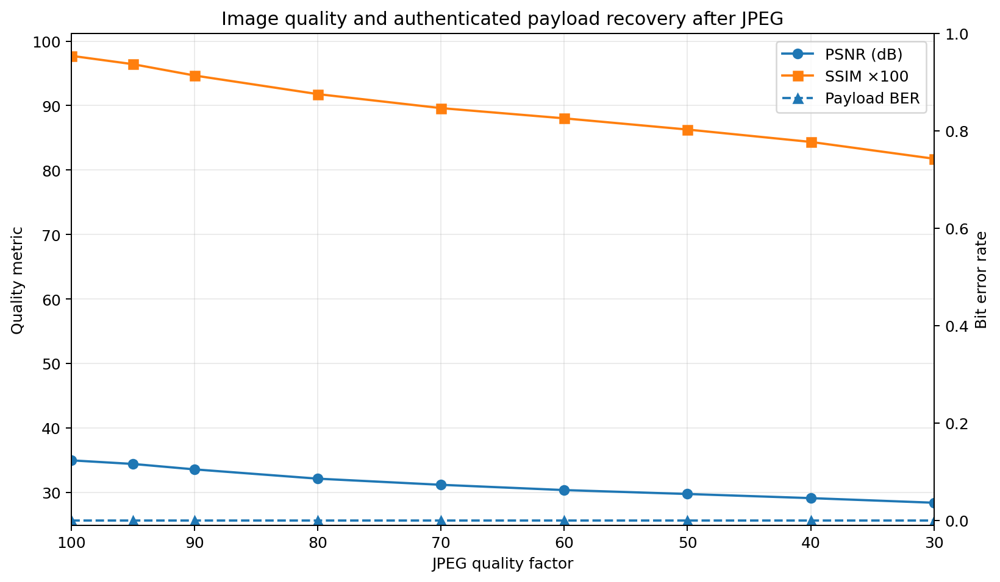

# DSP Invisible Watermark

[](https://github.com/eshwar-iiti/dsp-invisible-watermark/actions/workflows/ci.yml)
[](https://www.python.org/)
[](LICENSE)
[](#dsp-architecture)

A keyed, invisible image and video watermarking system built around **multi-level 2D-DWT**, **block DCT**, **spread-transform dither modulation (STDM)**, an optional **SVD-QIM** backend, convolutional error correction, and authenticated payload framing.

The default image preset is designed for a practical operating point: high visual quality, blind recovery after common compression/noise/filtering attacks, and optional semi-blind geometric registration for rotation and scaling. The video path adds a temporal Haar stage, multi-frame soft voting, phase search, and GOP/keyframe-aligned H.264/H.265 output.

> **Measured default result:** on the repository's deterministic 512×512 cover, the watermarked image reaches **46.53 dB PSNR**, **0.9937 SSIM**, and authenticated **BER = 0** for JPEG Q=50, 5° rotation with registration, median filtering, and AWGN σ=10. Re-run `python generate_assets.py` to reproduce the table and figures on your machine.



## Features

- **Blind image watermark extraction** for compression, additive noise, and filtering attacks.
- **Semi-blind geometric synchronization** using ORB + RANSAC similarity registration, with homography/ECC fallbacks.
- **Hybrid transform pipeline:** luminance → level-3 2D-DWT → `LH₃`/`HL₃` → block DCT → keyed STDM or SVD-QIM.
- **Secret-key carrier randomization:** HMAC-derived coefficient permutation, balanced ±1 PN chips, dither, and payload whitening.
- **Payload reliability:** rate-1/2, constraint-length-7 convolutional code with soft-decision Viterbi decoding; repetition mode remains available.
- **Payload integrity:** versioned framing, declared length, CRC-32, and a configurable truncated HMAC tag.
- **Spatio-temporal video watermarking:** temporal Haar low-pass embedding, repeated temporal planes, phase search, and soft-score voting.
- **Codec-aware output:** FFmpeg-backed H.264/H.265 encoding, audio remuxing, and forced periodic keyframes aligned to embedding groups.
- **Attack laboratory:** JPEG, AWGN, Gaussian/median blur, rotation, scaling, crop-and-resize, salt-and-pepper noise, H.264/H.265 recompression, frame dropping, and frame-rate conversion.
- **Reproducibility:** deterministic asset generator, JSON/CSV/Markdown benchmark output, versioned manifests, unit/integration tests, linting, packaging, and GitHub Actions CI.

## Repository layout

```text
dsp-invisible-watermark/
├── core/
│   ├── __init__.py
│   ├── config.py             # Validated image/video configurations
│   ├── transforms.py         # 2D/temporal DWT, DCT, SVD, block utilities
│   ├── carriers.py           # DWT sub-band carrier layouts
│   ├── spread_spectrum.py    # Keyed PN + STDM embedding/extraction
│   ├── qim.py                # Dithered parity-QIM primitives
│   ├── payload.py            # Framing, CRC, HMAC, whitening, ECC/Viterbi
│   ├── registration.py       # ORB/RANSAC, homography, and ECC alignment
│   ├── embedder.py           # Image and spatio-temporal video embedders
│   ├── extractor.py          # Blind/semi-blind image and video extraction
│   ├── metrics.py            # MSE, PSNR, SSIM, BER, NC
│   ├── media.py              # Unicode-safe image I/O and luminance handling
│   ├── video_io.py           # Video probing, lossless staging, audio remux
│   └── exceptions.py
├── attacks/
│   ├── spatial.py            # AWGN, blur, crop, rotation, scale, impulse noise
│   ├── compression.py        # JPEG and FFmpeg H.264/H.265 attacks
│   └── temporal.py           # Frame dropping and frame-rate conversion
├── benchmarks/
│   ├── sample_data.py        # License-free deterministic image/video fixtures
│   ├── run_benchmarks.py     # Image attack suite
│   └── run_video_benchmarks.py
├── tests/                    # Unit, CLI, robustness, and video integration tests
├── examples/                 # API quickstart and deterministic sample-video tool
├── docs/                     # Algorithm and benchmark methodology references
├── assets/                   # Generated figures and machine-readable results
├── .github/workflows/ci.yml
├── cli.py
├── generate_assets.py
├── pyproject.toml
├── MANIFEST.in
├── requirements.txt
├── requirements-dev.txt
├── Makefile
├── CHANGELOG.md
├── CONTRIBUTING.md
├── SECURITY.md
└── LICENSE
```

# DSP architecture

## 1. Luminance-domain processing

For color media, the input BGR frame is converted to YCrCb and only the luminance plane is modified. Chroma and any alpha channel are preserved. This concentrates the watermark in a channel that survives common codecs while avoiding visible color shifts.

Let the host luminance plane be

$$
Y \in [0,255]^{H\times W}.
$$

It is reflect-padded to a multiple of

$$
M = 2^L B,
$$

where $L$ is the DWT level and $B$ is the DCT block size. Padding metadata is retained and removed after reconstruction.

## 2. Multi-level 2D-DWT decomposition

A separable wavelet decomposition applies low-pass $h[n]$ and high-pass $g[n]$ analysis filters along rows and columns, followed by dyadic downsampling. At one level,

$$
\begin{aligned}
LL(i,j) &= \sum_m\sum_n Y(m,n)h(2i-m)h(2j-n),\\
LH(i,j) &= \sum_m\sum_n Y(m,n)h(2i-m)g(2j-n),\\
HL(i,j) &= \sum_m\sum_n Y(m,n)g(2i-m)h(2j-n),\\
HH(i,j) &= \sum_m\sum_n Y(m,n)g(2i-m)g(2j-n).
\end{aligned}
$$

The approximation $LL$ is recursively decomposed to level $L=3$. The default embeds into `LH₃` and `HL₃`: these mid-frequency orientation bands offer a better imperceptibility/robustness compromise than altering the low-frequency approximation or the most fragile diagonal detail band.



## 3. Block DCT and coefficient selection

Each selected DWT band is partitioned into $B\times B$ blocks. For a block $x[m,n]$, the orthonormal 2D DCT-II is

$$
C[u,v] = \alpha(u)\alpha(v)
\sum_{m=0}^{B-1}\sum_{n=0}^{B-1}
x[m,n]
\cos\!\left[\frac{\pi(2m+1)u}{2B}\right]
\cos\!\left[\frac{\pi(2n+1)v}{2B}\right],
$$

with

$$
\alpha(0)=\sqrt{\frac{1}{B}},\qquad
\alpha(k)=\sqrt{\frac{2}{B}}\;\text{for }k>0.
$$

The DC term $C[0,0]$ is excluded. Remaining coefficients are ordered by JPEG-style zig-zag traversal; the default uses 15 non-DC coefficients from each 4×4 block.

## 4. Default keyed spread-transform dither modulation

The selected scalar DCT coefficients are packed into a vector $\mathbf{x}$. A secret key $K$ is expanded with HMAC-SHA-256 into independent domains for:

- a carrier permutation $\pi_K$;
- balanced pseudo-noise sequences $\mathbf{p}_i\in\{-1,+1\}^{N_c}$;
- subtractive dithers $d_i\in[0,\Delta)$;
- payload whitening streams.

For coded bit $b_i\in\{0,1\}$, take the keyed chip

$$
\mathbf{x}_i =
\left[x_{\pi_K(iN_c)},\ldots,x_{\pi_K(iN_c+N_c-1)}\right]^T
$$

and its PN projection

$$
z_i = \frac{1}{N_c}\mathbf{p}_i^T\mathbf{x}_i.
$$

The two parity lattices are

$$
\Lambda_b(d_i)=\left\{d_i+\Delta(2k+b):k\in\mathbb{Z}\right\}.
$$

Embed by finding the nearest point in the lattice selected by the bit,

$$
z_i' = Q_{b_i}(z_i-d_i)+d_i,
$$

then distribute the projection error across the chip:

$$
\boxed{\mathbf{x}_i' = \mathbf{x}_i + (z_i'-z_i)\mathbf{p}_i.}
$$

Because $\|\mathbf{p}_i\|_2^2=N_c$, the new normalized projection is exactly $z_i'$. The extractor repeats the keyed projection and computes a soft score from the distance to the even and odd QIM lattices. Those scores feed the Viterbi decoder; no original cover is needed.

The main strength/capacity controls are the quantizer step $\Delta$, chip length $N_c$, DWT level, sub-band set, block size, and selected coefficients per block.

## 5. Optional DWT-DCT-SVD backend

For every selected DCT block,

$$
C = U\Sigma V^T,
\qquad
\Sigma = \operatorname{diag}(\sigma_0,\sigma_1,\ldots).
$$

A classical additive SVD watermark changes the singular values as

$$
\boxed{\Sigma_{\text{watermarked}} = \Sigma + \alpha W.}
$$

The implemented `svd-qim` backend replaces direct addition with keyed parity QIM on a chosen singular value:

$$
\sigma_k' = \underset{q\in\Lambda_b(d)}{\operatorname{argmin}}\;|\sigma_k-q|,
\qquad
C' = U\Sigma'V^T.
$$

This preserves blind bit decisions and constrains non-leading singular values to remain ordered. It is included for research comparisons; the STDM backend is the robust default.

## 6. Framing, ECC, and authentication

The logical payload is framed as

```text
magic | version | flags | payload_length | CRC32 | payload | HMAC_tag
```

Header and body are independently whitened with key-derived bit streams. The default channel code is a terminated rate-1/2 convolutional code with constraint length $K=7$ and generators

$$
(g_0,g_1)=(171_8,133_8).
$$

Extraction uses a soft-decision Viterbi decoder. CRC detects accidental corruption; the truncated HMAC rejects wrong keys and forged payloads. This is payload authentication—not media encryption, DRM, or a public ownership proof.

## 7. Inverse pipeline

Modified coefficients are inverse-DCT transformed, reassembled into `LH₃`/`HL₃`, and passed through the inverse multi-level DWT. After cropping the transform padding, the luminance plane is clipped, rounded, and merged with the untouched chroma/alpha channels.



# Spatio-temporal video watermarking

The video pipeline is a separable 3D transform: a one-level Haar transform along time followed by the spatial image transform inside each temporal low-pass plane.

For pairs of luminance frames,

$$
L_t = \frac{Y_{2t}+Y_{2t+1}}{\sqrt{2}},
\qquad
H_t = \frac{Y_{2t}-Y_{2t+1}}{\sqrt{2}}.
$$

The watermark is embedded into every selected $L_t$, while $H_t$ is retained. Reconstruction uses

$$
\widehat{Y}_{2t}=\frac{\widehat{L}_t+H_t}{\sqrt{2}},
\qquad
\widehat{Y}_{2t+1}=\frac{\widehat{L}_t-H_t}{\sqrt{2}}.
$$

This makes paired frames share the same low-frequency watermark perturbation, reducing temporal flicker. The default video preset raises spatial $\Delta$ from 12 to 16 before temporal reconstruction to compensate for attenuation and inter-frame quantization.

Frames are processed in configurable temporal windows (default 8). The encoder can embed every $G$-th group and forces output keyframes/GOP boundaries at the same group interval. During extraction:

1. each complete temporal window is Haar-decomposed;
2. soft STDM scores are recovered from every temporal low-pass plane;
3. scores are clipped and averaged across frames;
4. temporal starting phases are searched after frame deletion/rate conversion;
5. the candidate with the strongest valid header/CRC/HMAC evidence is returned.

This repetition and voting strategy is robust to ordinary H.264/H.265 transcoding, isolated frame loss, and moderate frame-rate conversion. It does not guarantee survival after arbitrary editing, severe cropping, scene replacement, or aggressive generational compression.

# Installation

## Prerequisites

- Python 3.10 or newer.
- The `ffmpeg` and `ffprobe` executables on `PATH` for video embedding and attacks.
- Enough spatial capacity for the framed/ECC-coded payload. The default 512×512 preset holds 40 payload bytes.

Linux example:

```bash
sudo apt-get update
sudo apt-get install -y ffmpeg
```

macOS example:

```bash
brew install ffmpeg
```

Windows example:

```powershell
winget install Gyan.FFmpeg
```

## Environment

```bash
git clone https://github.com/eshwar-iiti/dsp-invisible-watermark.git
cd dsp-invisible-watermark
python -m venv .venv
```

Activate it:

```bash
# Linux/macOS
source .venv/bin/activate

# Windows PowerShell
.venv\Scripts\Activate.ps1
```

Install:

```bash
python -m pip install --upgrade pip
python -m pip install -e .
```

Development environment:

```bash
python -m pip install -e ".[dev]"
```

Verify:

```bash
dsp-watermark --version
ffmpeg -version
pytest -m "not integration"
pytest -m integration
```

Run the API quickstart and create a local sample video:

```bash
python examples/quickstart.py
python examples/generate_sample_video.py --output output/sample-input.avi
```

# CLI usage

Keys must contain at least 8 bytes. Prefer an environment variable or protected key file so the secret is not retained in shell history.

```bash
# Linux/macOS
export DSP_WATERMARK_KEY='replace-with-a-long-random-production-secret'

# Windows PowerShell
$env:DSP_WATERMARK_KEY='replace-with-a-long-random-production-secret'
```

Every embed command writes a sidecar manifest by default, for example `marked.png.wm.json`. It stores the transform configuration, original dimensions, payload length, hashes, and quality/report metadata—but never stores the secret key or plaintext payload.

## Image embedding

Text payload:

```bash
dsp-watermark image embed \
  --input assets/original.png \
  --output output/marked.png \
  --message "asset-id:42"
```

Binary payload:

```bash
dsp-watermark image embed \
  --input assets/original.png \
  --output output/marked.png \
  --payload-file metadata.bin \
  --key-file secrets/watermark.key
```

The output should preferably be PNG for storage. JPEG can be used, but saving directly to a lossy format immediately applies a compression channel.

## Image extraction

Blind extraction using the sidecar manifest:

```bash
dsp-watermark image extract \
  --input output/marked.png \
  --manifest output/marked.png.wm.json
```

Write arbitrary recovered bytes to a file:

```bash
dsp-watermark image extract \
  --input output/marked.png \
  --manifest output/marked.png.wm.json \
  --output-payload recovered.bin
```

For rotation, scale, and crop attacks, provide the original cover as a registration reference:

```bash
dsp-watermark image extract \
  --input output/rotated.png \
  --manifest output/marked.png.wm.json \
  --reference assets/original.png
```

Without a manifest, supply the same transform settings and, when a header is too damaged, the expected payload length:

```bash
dsp-watermark image extract \
  --input output/attacked.jpg \
  --expected-bytes 11 \
  --dwt-level 3 --delta 12 --chip-length 8 --subbands LH,HL
```

## Capacity planning

```bash
dsp-watermark image capacity --width 512 --height 512
```

Default capacity examples are transform- and ECC-dependent:

| Resolution | Default payload capacity |
|---:|---:|
| 256×256 | 0 bytes (header/auth overhead fills the channel) |
| 384×384 | 14 bytes |
| 512×512 | 40 bytes |
| 1024×1024 | 220 bytes |

For smaller media, reduce overhead or use a lower DWT level/chip length only after benchmarking the robustness loss.

## Image attack benchmark

```bash
dsp-watermark image benchmark \
  --input assets/original.png \
  --message "DSP-WATERMARK-2026" \
  --json-output results/image-benchmark.json \
  --markdown-output results/image-benchmark.md
```

## Video embedding

Input may be `.mp4`, `.avi`, `.mkv`, or another format readable by OpenCV/FFmpeg. Output should normally be `.mp4` for H.264/H.265.

```bash
dsp-watermark video embed \
  --input input.mp4 \
  --output output/marked.mp4 \
  --message "asset-id:42" \
  --codec libx264 --crf 18 --preset medium
```

H.265 output:

```bash
dsp-watermark video embed \
  --input input.avi \
  --output output/marked-h265.mp4 \
  --message "asset-id:42" \
  --codec libx265 --crf 20
```

Useful controls:

```text
--temporal-window 8       even number of frames in each Haar group
--group-interval 1        embed every temporal group
--max-samples 64          maximum low-pass planes used for voting
--no-keyframe-alignment   do not force output keyframes at group boundaries
--no-phase-search         skip temporal offset search
--no-audio                do not remux source audio
```

## Video extraction

```bash
dsp-watermark video extract \
  --input output/marked.mp4 \
  --manifest output/marked.mp4.wm.json
```

## Video attacks and benchmark

Apply an additional compression generation:

```bash
dsp-watermark video compress \
  --input output/marked.mp4 \
  --output output/marked-crf28.mp4 \
  --codec libx264 --crf 28
```

Run H.264, frame-drop, and frame-rate attacks:

```bash
dsp-watermark video benchmark \
  --input input.mp4 \
  --message "VIDEO" \
  --output-dir results/video \
  --json-output results/video-benchmark.json
```

The committed 24-frame test vector produces:

| Video attack | Payload BER | Authenticated | Temporal samples |
|---|---:|:---:|---:|
| No additional attack | **0.0000** | ✅ | 12 |
| H.264 CRF 28 | **0.0000** | ✅ | 12 |
| H.265 CRF 30 | **0.0000** | ✅ | 12 |
| Drop every 8th frame | **0.0000** | ✅ | 12 |
| Frame-rate conversion 12 → 9 fps | **0.0000** | ✅ | 12 |

Raw results are stored in [`assets/video_robustness.json`](assets/video_robustness.json).

# Python API

```python
from core import (
    ImageWatermarkConfig,
    ImageWatermarker,
    ImageWatermarkExtractor,
    image_quality,
)
from core.media import read_image

key = b"a-long-secret-key"
payload = b"asset-id:42"
config = ImageWatermarkConfig(
    algorithm="stdm",
    dwt_level=3,
    block_size=4,
    delta=12.0,
    subbands=("LH", "HL"),
    spread_chip_length=8,
)

embedder = ImageWatermarker(config)
report = embedder.embed_file("cover.png", "marked.png", payload, key)

extractor = ImageWatermarkExtractor(config)
result = extractor.extract_file(
    "marked.png",
    key,
    expected_payload_bytes=len(payload),
)
assert result.valid and result.payload == payload

quality = image_quality(read_image("cover.png"), read_image("marked.png"))
print(report.to_dict())
print(result.to_dict())
print(quality.to_dict())
```

# Configuration guide

## Image configuration

| Field | Default | Effect |
|---|---:|---|
| `algorithm` | `stdm` | Robust PN/STDM default; `svd-qim` is the research alternative. |
| `wavelet` | `haar` | Spatial wavelet. PyWavelets enables additional discrete wavelets. |
| `dwt_level` | `3` | Embeds in level-$L$ details; higher levels are coarser and lower-capacity. |
| `block_size` | `4` | DCT block width/height. |
| `delta` | `12.0` | QIM spacing; larger is more robust but less imperceptible. |
| `subbands` | `LH,HL` | Orientation bands carrying the watermark. |
| `spread_chip_length` | `8` | DCT coefficients per physical bit; larger improves spreading but lowers capacity. |
| `spread_coefficients_per_block` | `15` | Non-DC zig-zag coefficients available from each 4×4 block. |
| `ecc_mode` | `convolutional` | Soft Viterbi channel code; `repetition` is simpler but weaker. |
| `auth_tag_bytes` | `8` | Truncated HMAC length. |

## Video configuration

| Field | Default | Effect |
|---|---:|---|
| `image.delta` | `16.0` | Stronger spatial step before temporal inverse transform. |
| `temporal_window` | `8` | Frames per separable 3D transform group. |
| `embed_group_interval` | `1` | Embed every $G$-th temporal group. |
| `codec` | `libx264` | FFmpeg output encoder; `libx265` is supported. |
| `crf` | `18` | Output quality/size control passed to the encoder. |
| `align_output_keyframes` | `true` | Force GOP/keyframe interval to match embedded temporal groups. |
| `extraction_max_samples` | `64` | Upper bound on low-pass score vectors used for voting. |
| `search_temporal_phase` | `true` | Search offsets $0,\ldots,T-1$ after temporal attacks. |

# Visual benchmarks

## Imperceptibility

| Item | Result |
|---|---:|
| Cover size | 512×512 RGB |
| Payload | 18 UTF-8 bytes |
| Capacity | 40 payload bytes |
| Transform | Haar DWT level 3 + 4×4 DCT + STDM |
| Embedded bands | `LH₃`, `HL₃` |
| Baseline PSNR | **46.53 dB** |
| Baseline SSIM | **0.9937** |
| Blind authenticated recovery | **Pass** |

The residual image above is magnified by 10 and centered at gray; it is not the visible appearance of the marked image.

## JPEG quality curve



The exact samples are stored in [`assets/compression_curve.json`](assets/compression_curve.json).

## Required robustness table

Generated from `assets/robustness.json` by the committed benchmark script:

| Attack | Payload BER | PSNR vs. cover (dB) | SSIM vs. cover | Authenticated recovery |
|---|---:|---:|---:|:---:|
| No attack | **0.0000** | **46.53** | **0.9937** | ✅ |
| JPEG Q=50 | **0.0000** | 29.74 | 0.8629 | ✅ |
| Rotation 5° + ORB/RANSAC registration | **0.0000** | 30.66 | 0.9593 | ✅ |
| Median filter 3×3 | **0.0000** | 35.26 | 0.9020 | ✅ |
| AWGN $\sigma=10$ | **0.0000** | 28.09 | 0.6223 | ✅ |

PSNR/SSIM in attacked rows compare the *attacked* image with the cover, so they measure watermark distortion plus the attack itself. The imperceptibility target applies to the un-attacked watermarked image. Geometric quality is measured after the same registration used for extraction.

The expanded generated table also includes blur, scale, and crop. In the current default benchmark, scale 0.75× recovers with BER 0; center crop retaining 90% in each dimension does not authenticate. This limitation is reported rather than hidden: ordinary DWT/DCT watermarking is not inherently desynchronization-invariant, and severe crop robustness needs template synchronization, tiling, or local feature-domain embedding.

# Generate assets

```bash
python generate_assets.py

# Also run real H.264/frame-drop/frame-rate tests
python generate_assets.py --include-video
```

Outputs:

```text
assets/original.png
assets/watermarked.png
assets/original_vs_watermarked.png
assets/residual_x10.png
assets/dwt_subbands.png
assets/compression_curve.png
assets/compression_curve.json
assets/robustness.csv
assets/robustness.json
assets/robustness.md
assets/summary.json
assets/video_robustness.json     # with --include-video
assets/video_robustness.md       # with --include-video
```

Use another output directory without changing committed documentation:

```bash
python generate_assets.py --output-dir /tmp/dsp-watermark-assets
```

# Tests and quality gates

```bash
ruff check .
pytest -m "not integration"
pytest -m integration
pytest --cov=core --cov=attacks --cov-report=html
python -m build
```

The integration marker invokes real video encoders and therefore requires FFmpeg with `libx264`. GitHub Actions runs unit tests on Python 3.10, 3.12, and 3.13; video and asset smoke tests run on Python 3.12.

# Engineering notes and limitations

- **Capacity is not free.** Headers, termination bits, ECC, and HMAC consume carriers before payload bytes. Query capacity before embedding.
- **Blind does not mean invariant.** Compression/noise/filtering remain blind; rotation/scale/crop use optional reference registration.
- **Do not expose keys.** A wrong key produces a different carrier order, PN sequence, dither, whitening stream, and HMAC result.
- **Avoid repeated lossy saves.** Every JPEG or video transcode consumes robustness margin.
- **Codec behavior varies.** Encoder build, chroma subsampling, rate control, resize kernels, and scene content affect BER.
- **Flat media is difficult.** Highly uniform covers have fewer masking opportunities; the implementation currently uses fixed strength rather than a full human-visual-system masking model.
- **Crop remains the hardest listed attack.** The code implements it and reports failure transparently for the default 90%-per-axis crop fixture.
- **This is not steganographic deniability.** Statistical detectors may distinguish marked from unmarked populations even when viewers cannot see a difference.
- **This is not legal proof by itself.** Ownership systems normally combine watermark evidence with signed records, access controls, and chain-of-custody procedures.

# License

MIT. See [LICENSE](LICENSE).
